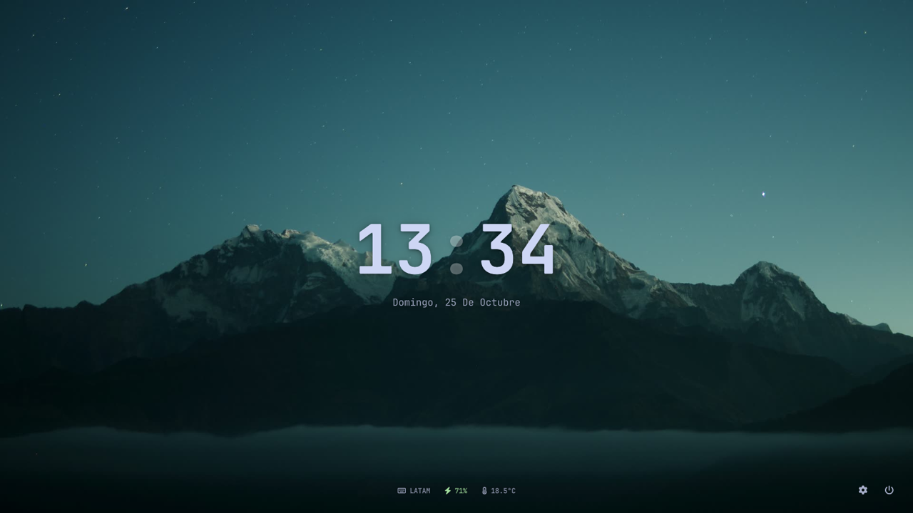
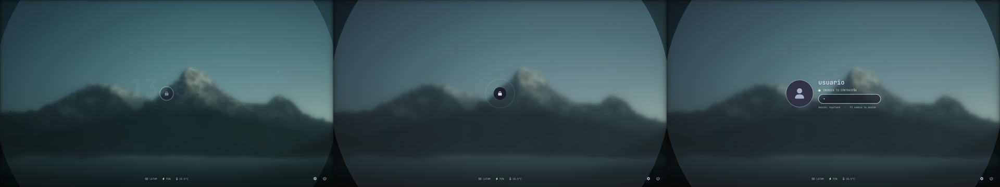
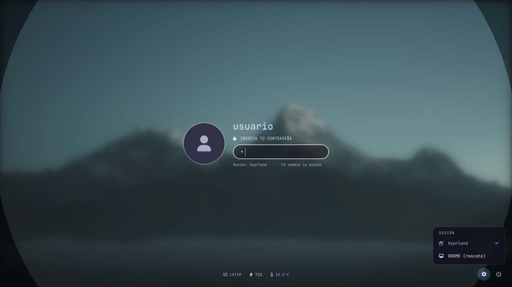
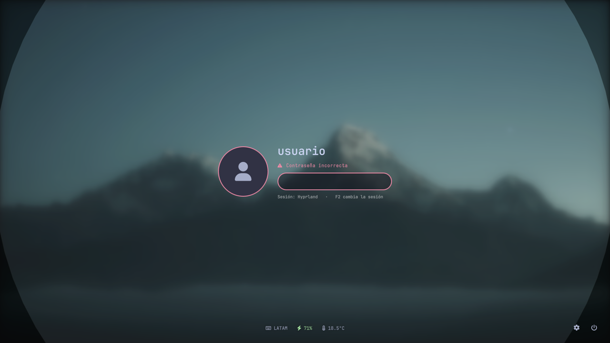

# serpantinum-greeter


Login (greeter) para **[greetd](https://sr.ht/~kennylevinsen/greetd/)**, hecho en
**[Quickshell](https://quickshell.org)**, con el diseño de la pantalla de bloqueo de
**[Serpantinum](https://github.com/ilyamiro/serpantinum)**.


> **English:** a greetd greeter written in Quickshell (QML) that mimics Serpantinum's lock screen:
> a lock-icon transition, a session picker (Hyprland / GNOME as a rescue session), multi-monitor
> support, a desktop-synced wallpaper and weather without network access, and hardening so the
> password never ends up in logs. Runs inside `cage` (kiosk). AGPL-3.0-or-later.

## Qué hace
- **Al encender:** el fondo de tu escritorio, nítido, con el reloj.
- **Al presionar una tecla o hacer clic:** el fondo se desenfoca dentro de un círculo, un anillo se
  expande, aparece el candado, crece y se desvanece, y entra el formulario. `Esc` vuelve al reloj.
- **Contraseña incorrecta:** el formulario tiembla y el borde se pone rojo.
- **Al entrar:** el círculo se abre y queda el fondo nítido, sin fundido a negro.
- ⚙️ **Engranaje** para elegir la sesión: **Hyprland** (por defecto) o **GNOME** (rescate). También con `F2`.
- Apagar y reiniciar · abajo: teclado, batería y temperatura.
- **Varios monitores:** el login en el principal; los demás muestran el mismo fondo del escritorio, un poco oscurecido.

## Capturas
| Al encender | La transición del candado |
|---|---|
|  |  |

| ⚙️ Elegir la sesión | Contraseña incorrecta |
|---|---|
|  |  |

**Al entrar** (el círculo se abre y queda el fondo nítido):


**Dos monitores** (el login en el principal; el otro muestra el mismo fondo del escritorio, un poco oscurecido):


<sub>Fondo: foto de [Daniel Leone](https://unsplash.com/photos/v7daTKlZzaw) en Unsplash ([licencia de Unsplash](https://unsplash.com/license)). Capturas y demo generadas en un compositor *headless* con usuario y clima de ejemplo.</sub>

## Requisitos
| Paquete | Para qué |
|---|---|
| `greetd` | El "portero": habla con PAM y abre la sesión |
| `cage` | Compositor *kiosk*: una sola app, sin atajos ni lanzador |
| `quickshell` (0.2.1 o 0.3.x, con `Quickshell.Services.Greetd` y la opción `--no-detailed-logs`) | Dibuja el login |
| `wlr-randr`, `jq` | Ordenar los monitores dentro de cage |
| Fuentes `JetBrains Mono` e `Iosevka Nerd Font` | Textos e íconos |
| Opcional: `pamtester` | Probar el PAM antes de usarlo (muy recomendado) |

En Fedora: `sudo dnf install greetd greetd-selinux cage wlr-randr jq pamtester`. Para Quickshell 0.3.x,
el COPR `errornointernet/quickshell` (limítalo con `includepkgs=quickshell*,cpptrace*`).

## Instalación (con red de seguridad)
> ⚠️ Es tu **login**: si algo sale mal, podrías no entrar. Sigue el orden y **no cambies tu gestor de
> login hasta que la prueba del paso 4 funcione**. Ten a mano una TTY (`Ctrl + Alt + F3`).

**1. Copiar los archivos** (son de root, para que el login no pueda modificar su propio código):
```bash
sudo install -d -m 755 /usr/local/share/serpantinum-greeter
sudo install -m 644 shell.qml Greeter.qml Fondo.qml /usr/local/share/serpantinum-greeter/
sudo install -m 755 greetd/serpantinum-greeter-{launch,layout,user} /usr/local/bin/
sudo install -m 644 greetd/prueba.toml /etc/greetd/prueba.toml
```

**2. Revisar el PAM de greetd** (`/etc/pam.d/greetd`). Para que tu contraseña **abra el llavero**
(GNOME Keyring), debe tener `pam_gnome_keyring.so` en `auth` y en `session` (con `auto_start`), y usar
`substack` (no `include`) para la autenticación. En Fedora conviene cambiar `system-auth` por
`password-auth` (como SDDM): así no se puede entrar solo con la huella, que dejaría el llavero cerrado.

**3. Probar el PAM** (pregunta tu contraseña, no abre ninguna sesión):
```bash
pamtester greetd "$USER" authenticate   # debe decir: successfully authenticated
```

**4. Probar el login en otra VT**, sin tocar tu gestor de login actual. Cierra tu sesión, entra en
una TTY y ejecuta:
```bash
sudo systemd-run --unit=greetd-prueba -p KeyringMode=shared /usr/bin/greetd --config /etc/greetd/prueba.toml
```
El login aparece en la VT 5. Entra, prueba la sesión de rescate (GNOME) y la principal. Al terminar:
`Ctrl + Alt + F3` → `sudo systemctl stop greetd-prueba`.

**5. Cambiarlo como login** (solo si el paso 4 funcionó):
```bash
sudo cp -a /etc/greetd/config.toml /etc/greetd/config.toml.original
sudo install -m 644 greetd/config.toml /etc/greetd/config.toml
sudo systemctl disable sddm      # o gdm: el gestor que tengas (los dos ocupan display-manager.service)
sudo systemctl enable greetd
```

**Vuelta atrás** (desde una TTY): `sudo systemctl disable greetd && sudo systemctl enable sddm && sudo reboot`.

**Opcional:** el fondo y el clima del escritorio en el login (ver [Fondo y clima](#fondo-y-clima-sincronizados-sync))
y `sg-post-update` (ver [Después de actualizar Serpantinum](#después-de-actualizar-serpantinum-toolssg-post-update)).

## Seguridad
- **Nunca sale a internet.** La temperatura se lee de un archivo local (`SG_CLIMA`) que solo debe
  contener `current_temp_formatted`, `current_icon` y `fetched_at` (sin coordenadas). Se valida con
  una expresión regular y se ignora si tiene más de 12 h.
- Corre dentro de **cage** (*kiosk*) como el usuario `greetd`: no hay escritorio, ni terminal, ni atajos
  que abrir. Si el login gráfico falla, cae a `agreety` (login en modo texto).
- Todo texto dinámico usa `Text.PlainText` (no se interpreta HTML de mensajes de PAM o del archivo).
- `Greetd.launch()` solo se llama si `Greetd.state === ReadyToLaunch` (PAM ya aceptó la contraseña).
- La contraseña se borra del campo y de memoria (`pending`) apenas se envía; 1 s de espera tras un error.
- Campo de contraseña: sin selección, sin método de entrada predictivo, máximo 256 caracteres.
- Los únicos procesos que puede lanzar: `systemctl reboot` / `systemctl poweroff` (lista cerrada).
- **Registros mínimos:** Quickshell anota en depuración los mensajes que intercambia con greetd; la respuesta
  con la contraseña ya aparece censurada (`"response":"<CENSORED>"`). Como precaución extra, el lanzador
  apaga la depuración (`QT_LOGGING_RULES="*.debug=false"`, `--log-rules "*.debug=false"`) y el registro
  detallado (`--no-detailed-logs`). Los mensajes de cage y Quickshell van al journal
  (`journalctl -t serpantinum-greeter`), no a la pantalla.

## Modo prueba
Si `GREETD_SOCK` no existe (es decir, si no lo lanzó greetd), funciona en **modo prueba**:
no se conecta a nada, no inicia sesión, no apaga ni reinicia. Se ve un aviso naranja arriba.
```bash
SG_USER="$USER" quickshell -p .
```
Teclas: cualquier tecla muestra el formulario · `Enter` envía · `F2` cambia la sesión · `Esc` vuelve al reloj.

## Configuración (variables de entorno)
| Variable | Por defecto |
|---|---|
| `SG_USER` | Se detecta solo (`greetd/serpantinum-greeter-user`): el usuario con UID entre `UID_MIN` y `UID_MAX` de `/etc/login.defs` y un shell de `/etc/shells`. Si hay varios, el de UID más bajo; si no hay ninguno, se usa `agreety` |
| `SG_FONDOS` | `/var/lib/serpantinum-greeter` (usa `fondo-<monitor>`, luego `fondo`, luego `/usr/share/sddm/themes/material-you/bg.png`) |
| `SG_PANTALLA` | `eDP-1,HDMI-A-1` (el login va en el primero conectado; los demás muestran su fondo) |
| `SG_IZQ` / `SG_DER` | `HDMI-A-1` / `eDP-1` (orden de los monitores en cage) |
| `SG_AVATAR` | `/var/lib/AccountsService/icons/$SG_USER` |
| `SG_KB` | `LATAM` |
| `SG_CLIMA` | `/var/lib/serpantinum-greeter/clima.json` |
| `SG_TRANSICION` | `video` (o `cortina`) |

Las rutas deben poder leerse por el usuario del greeter (no desde `~`, que es privada).

## Fondo y clima sincronizados (`sync/`)
El login usa **el mismo fondo del escritorio** para que entrar se sienta continuo.
`sg-sync.sh` (servicio de usuario) copia a `/var/lib/serpantinum-greeter/`:
- `fondo` y `fondo-<monitor>`: las capturas que guarda Serpantinum (`current_wallpaper*.png`), así que sirve también para fondos de video.
- `clima.json`: **solo** `current_temp_formatted`, `current_icon` y `fetched_at`. Las coordenadas nunca salen de `~/.cache`.

Valida que sea una imagen (jpeg/png/webp, máximo 40 MB), copia de forma atómica (temporal + `mv`) y usa `flock`.
`sg-sync.path` lo vuelve a ejecutar cuando cambia el fondo o el clima.
```bash
sudo install -d -o "$USER" -g "$USER" -m 755 /var/lib/serpantinum-greeter
install -Dm755 sync/sg-sync.sh ~/.local/bin/sg-sync
install -Dm644 -t ~/.config/systemd/user sync/sg-sync.service sync/sg-sync.path
systemctl --user daemon-reload && systemctl --user enable --now sg-sync.path sg-sync.service
```

## Varios monitores
`cage -m extend` + `serpantinum-greeter-layout` (pone `SG_IZQ` en 0,0 y `SG_DER` a su derecha con `wlr-randr`).
Una sola ventana cubre todos los monitores; el login va en el principal (recortado para que el círculo
no invada el otro) y los demás muestran el fondo del escritorio un poco oscurecido: el mismo en todos,
o el de cada monitor si Serpantinum usa uno distinto por pantalla (`fondo-<monitor>`).

## Cómo funciona con greetd
`Greetd.createSession(usuario)` → greetd pide la contraseña (`authMessage`) → `Greetd.respond()` →
`readyToLaunch` → `Greetd.launch(comando, entorno)` de la sesión elegida en el engranaje.
La contraseña pasa por PAM (`/etc/pam.d/greetd`), que también debe abrir el llavero de GNOME.

## Después de actualizar Serpantinum (`tools/sg-post-update`)
El instalador de Serpantinum puede volver a activar SDDM (`systemctl enable --force sddm`, incluso al
actualizar: desactiva "Instalar SDDM" en su menú) y reescribe `/etc/pam.d/serpantinum`.
```bash
install -Dm755 tools/sg-post-update ~/.local/bin/sg-post-update
sg-post-update              # solo revisa e informa (no cambia nada)
sg-post-update --arreglar   # vuelve a greetd y restaura pam/serpantinum (lo prueba con pamtester;
                            # si la contraseña no entra, deja la versión anterior)
```
Revisa: el gestor de login, el PAM, que el login instalado sea igual al del repo, que Quickshell
tenga `--no-detailed-logs` y que ninguna respuesta del login aparezca sin censurar en el journal, PipeWire fuera del login, `rfkill`,
los servicios de usuario y la capa personal frente al último respaldo.

Pruebas automáticas (no tocan el sistema; usan un `/etc` falso y dobles de `systemctl`, `pamtester`,
`journalctl`, `rfkill` y `quickshell`): `bash tools/test-sg-post-update.sh` → 18 casos.

## Estado y limitaciones
- Probado en **Fedora 44** con greetd 0.10.3, cage 0.3.1 y Quickshell 0.2.1 y 0.3.2, con SELinux en *enforcing*.
- **Un solo usuario:** muestra un usuario (detectado o `SG_USER`); todavía no hay selector de usuarios.
- Las sesiones (Hyprland y GNOME) están en `Greeter.qml`: para otras, edita esa lista.
- Al pasar del login a la sesión hay un instante negro: son dos programas distintos que se pasan la pantalla.
- Si tu PipeWire está activado para **todos** los usuarios (`systemctl --global`), el usuario del login
  puede quedarse con tus dispositivos Bluetooth: enmascáralo en `/var/lib/greetd/.config/systemd/user/`.

## Licencia
Copyright (C) 2026 Ekzzzzzz.

Este programa es software libre: puedes redistribuirlo y modificarlo bajo los términos de la
**GNU Affero General Public License** publicada por la Free Software Foundation, versión 3 o
(a tu elección) cualquier versión posterior. Ver [`LICENSE`](LICENSE).

El diseño está inspirado en la pantalla de bloqueo de [Serpantinum](https://github.com/ilyamiro/serpantinum)
(ilyamiro, también AGPL-3.0). El código de este repositorio está escrito desde cero.
